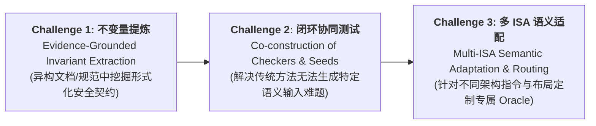

# DeFuzz 论文修订意见与写作参考指南 (Revision Notes & Writing Guide)

> **文档说明**：本文档汇总并整理了围绕 IEEE S&P (Oakland) 顶级安全会议标准进行的多次导师指导、线上研讨以及微信专项讨论（包括 8月31日会议录音、9月4日截图意见、9月8日与9月11日修改纪要）。
> 
> **重要状态声明**：**摘要（Abstract）现已正式定稿并锁定，禁止随意修改**。本文档全面收录定稿摘要范本及所有关键论证逻辑、挑战重构、术语规范与避坑指南，作为后续正文撰写、修改与投稿的最高权威参考。

---

## 目录
1. [已定稿摘要（Abstract 权威范本与解析）](#一-已定稿摘要abstract-权威范本与解析)
2. [微信专项讨论与截图意见核心提炼 (9月4日)](#二-微信专项讨论与截图意见核心提炼-9月4日)
3. [核心论据与学术论点深度阐释](#三-核心论据与学术论点深度阐释)
   - [为什么必须引入 Agent？（核心动机）](#1-为什么必须引入-agent核心动机)
   - [编译器防御实现是否 match ISA 的假设？（底层失效本质）](#2-编译器防御实现是否-match-isa-的假设底层失效本质)
   - [Invariants 究竟从哪里来？（知识溯源与防自证）](#3-invariants-究竟从哪里来知识溯源与防自证)
   - [Security vs. Safety 严格学术界限](#4-security-vs-safety-严格学术界限)
4. [三大耦合挑战与四大独立贡献对照体系](#四-三大耦合挑战与四大独立贡献对照体系)
5. [论文全篇“安全顶会八股”写作参考骨架](#五-论文全篇安全顶会八股写作参考骨架)
   - [Introduction 标准六步推进法](#1-introduction-标准六步推进法)
   - [Background & Motivation 案例讲透法](#2-background--motivation-案例讲透法)
   - [Threat Model 边界定义](#3-threat-model-边界定义)
6. [图表设计规范与学术品位（去流程化）](#六-图表设计规范与学术品位去流程化)
7. [历史核验记录与技术事实溯源](#七-历史核验记录与技术事实溯源)
8. [导师元建议与学术写作戒律](#八-导师元建议与学术写作戒律)

---

## 一、已定稿摘要（Abstract 权威范本与解析）

### 1. 定稿英文原文（锁定，禁止再修改）

```latex
Compiler-instrumented defenses, such as stack canaries, Control-Flow Integrity (CFI), 
and Pointer Authentication (PAC), provide an essential line of defense against memory-safety 
exploits. Yet these defenses can fail silently---leaving emitted binaries functionally 
normal but security-compromised without causing compiler crashes or execution divergence. 
CVE-2023-4039 exemplifies this vulnerability, where a dynamically allocated buffer bypasses 
the GCC stack protector on AArch64. Such failures expose a fundamental oracle gap: conventional 
crash and differential testing cannot detect whether an optimization pass has silently 
weakened or stripped an intended defense contract.

In this paper, we present DeFuzz, an invariant-directed agentic framework for discovering 
silent compiler defense failures. DeFuzz systematically addresses three coupled challenges:
(1) Evidence-Grounded Invariant Extraction: DeFuzz mines formal security contracts from 
compiler corpora, architectural specifications, and historical patches, coupling segmented 
Chain-of-Thought (CoT) with cross-mechanism abstract-failure transfer.
(2) Multi-ISA Deterministic Oracle Formulation: For each invariant, DeFuzz synthesizes separate 
static audit and dynamic sandbox checkers specialized across target ISAs (x86-64, AArch64, RISC-V), 
producing a deterministic four-state verdict (PASS, FAIL, NA, ERROR) with zero LLM involvement in bug adjudication.
(3) Invariant-Directed Closed-Loop Fuzzing: Governed by a deterministic orchestrator, an LLM Generator 
synthesizes anti-DCE probe seeds, while an adaptive Feedback Agent analyzes compiler execution logs 
and condition hits to drive seed mutation and checker evolution. Confirmed violations trigger 
automated delta-debugging and lateral bug amplification.

Evaluated on GCC and LLVM across multiple architectures, DeFuzz discovered [N] previously unknown 
silent compiler defense failures, of which [M] have been confirmed upstream. These findings underscore 
the necessity of integrating rigorous, invariant-grounded oracles into compiler testing pipelines.
```

### 2. 定稿摘要如何全面落实讨论意见

| 导师与讨论意见 | 定稿摘要的对应落实处理 |
| :--- | :--- |
| **使用 `compiler-instrumented defenses`** | 首句正式定名，不再使用不规范的 `compiler inserted defense`。 |
| **`including` 改少一点** | 删除了原稿中堆砌的 `including...` 长句，精简为 `such as stack canaries, CFI, and PAC` 三个经典代表。 |
| **不要解释太多原因，直接讲 CVE 后果** | 不纠缠于复杂的中间过程，直接点出 `CVE-2023-4039` 的核心安全后果：动态分配缓冲区完全旁路栈保护。 |
| **不要 `on a particular backend`** | 删除了狭隘的修饰限定，提升问题高度为广泛存在的后端静默失效。 |
| **体现 invariants 从哪里来** | 挑战 (1) 明确指出来源：*compiler corpora, architectural specifications, and historical patches*。 |
| **剔除执行流水账，按三大挑战展开** | 第二段彻底摒弃 `First... Second...` 的执行步骤流水账，重组为三大挑战与对应解决方案。 |
| **明确判定无 LLM 介入** | 挑战 (2) 强调四态判定：*producing a deterministic four-state verdict with zero LLM involvement in bug adjudication*。 |

---

## 二、微信专项讨论与截图意见核心提炼 (9月4日)

微信专项讨论重点聚焦于**标题重构、摘要瘦身、Agent 的真正动机以及三大挑战的科学切分**：

```
[讨论原稿要点]
1. compiler-instrumented defense
2. including 改少一点
3. 标题重构下 -> DeFuzz: Invariant-Guided Agentic Testing of Compiler-Instrumented Defenses
4. 体现下 invariants 从哪来
5. 不要 on a particular backend 了
6. 摘要不要解释太多原因，直接讲 cve 后果
7. 编译器防御实现是否 match ISA 的假设
8. 第二点挑战缩短：生成 Checker 时需要考虑 ISAs 的语义，针对 ISA 能否多做一些事情
9. 为什么必须引入 Agent？传统方法无法生成违背不变量的、有特定语义的输入
10. 三大挑战重构：
    - 不变量生成本身是一个挑战
    - 基于不变量做测试也是一个挑战，生成 checker 和生成种子合成一个挑战
    - 不同 ISA 作用与语义适配也是一个挑战
```

---

## 三、核心论据与学术论点深度阐释

### 1. 为什么必须引入 Agent？（核心动机）

在审稿过程中，审稿人最常提出的质疑是：*“为什么传统 Fuzzing 不行？为什么要大费周章引入 Agent？”* 本次讨论给出了强有力的学术论证：

* **传统变异/生成方法的根本局限（语义鸿沟）**：
  - 编译器防御静默失效的触发条件极其苛刻，往往需要极其精准的底层内存布局和语法结构（例如：必须在特定作用域内引入 VLA/alloca、必须配合特定指针转换打破逃逸分析、必须构造符合 ABI 约束的控制流跳转）。
  - 传统的语法引导或随机变异 Fuzzing（如 Csmith、YARPGen）完全是盲目的，其变异算子**无法感知并生成能够针对性触碰安全不变量边界的特定语义结构代码**，生成的测试用例绝大多数在前端或早早期就被 DCE（死代码消除）或常规优化剔除。
* **自由运行 Agent（Free-Running Agent）的缺陷**：
  - 若单纯让 LLM 自主写代码并自主判断是否有 Bug，会产生海量的**幻觉（Hallucination）与不可复现性**，安全顶会审稿人对此极度反感。
* **DeFuzz 的 Agent 定位与闭环价值**：
  - **生成端**：利用 LLM 的代码理解能力，以 Invariant 违例条件为引导，合成具备 Anti-DCE 探针和深层底层语义结构的种子输入；
  - **判定端**：**LLM 绝不参与 Bug 裁决**！裁决完全交由确定性的机器 Checker；
  - **反馈端**：Feedback Agent 根据编译日志、汇编指令模式和覆盖率反馈，指导下一轮变异与生成。

### 2. 编译器防御实现是否 match ISA 的假设？（底层失效本质）

* 很多编译器开发者潜意识认为前端/中端 IR 插入了保护逻辑，防御就完成了；
* 但编译器防御的最终承载体是**目标架构的机器指令与运行时栈/寄存器状态**；
* 后端 Lowering 阶段必须依赖对底层 ISA/ABI 的一系列假设（如栈增长方向、Callee/Caller 保存寄存器约定、帧指针与基指针布局、对齐规则等）。
* **失效的深层根因**：后端代码生成逻辑往往未能完全匹配当前目标 ISA 的具体语义或特殊寻址模式，导致在特定指令重排或栈调整下，防御逻辑被静默破坏（例如：AArch64 下寄存器传参约束导致的 Canary 残留、RISC-V 动态帧调整下的偏移量误算）。

### 3. Invariants 究竟从哪里来？（知识溯源与防自证）

论文必须严密阐述安全不变量的来源，杜绝“拿待测编译器现有的行为作为正确标准”的循环自证（Self-referential Fallacy）：
1. **编译器源码注释与内部架构文档**（Compiler Source Comments & Internal Architecture Docs，如 GCC `cfgexpand.cc`、LLVM `StackProtector.cpp` 明确宣称的保护契约）；
2. **硬件体系结构与 ABI 官方规范**（Hardware ISA & ABI Specifications，如 ARMv8-A Architecture Reference Manual、System V ABI 对栈布局和寄存器使用的硬性约束）；
3. **权威历史漏洞披露报告与修复补丁**（Historical CVE Reports & Upstream Fix Patches，从以往已确认的失效案例中抽象通用的安全守则）；
4. **原则声明**：待测编译器当前的编译产物仅作为被测对象，**不能直接充当不变量规范**。

### 4. Security vs. Safety 严格学术界限

* **Security（安全防护）**：针对存在**主动恶意对抗攻击者**的场景。攻击者利用输入操纵执行流、越权访问或劫持控制流。编译器防御机制（Canary、CFI、PAC）属于典型的 Security 防线。
* **Safety（功能安全性/可靠性）**：针对非对抗环境下的偶发故障、并发死锁或内存越界导致的意外崩溃。
* **写作铁律**：全文严格统一使用 `security invariants`、`security contracts`，除引用特定标准名词（如 memory safety）外，严禁在方法论中滥用 `safety invariants`。

---

## 四、三大耦合挑战与四大独立贡献对照体系

### 1. 三大耦合挑战（Three Coupled Challenges）

根据 9月4日讨论，挑战体系经过精炼与合并，形成互为支撑的有机整体：



1. **Challenge 1: Evidence-Grounded Invariant Extraction（知识提炼挑战）**  
   如何从非结构化、分散的编译器源码、历史补丁和 ISA 规范中，提炼出跨机制适用、形式化且机器可检查的底层安全不变量。
2. **Challenge 2: Invariant-Directed Closed-Loop Fuzzing（种子与 Checker 协同测试挑战）**  
   传统 Fuzzing 无法生成违背不变量的特定语义输入，而 Free Agent 存在幻觉；必须解决将 Invariant 转化为可执行静态/动态 Checker，同时引导 Agent 生成具备特定深层语义结构输入的闭环挑战。
3. **Challenge 3: Multi-ISA Semantic Adaptation & Routing（多架构底层适配挑战）**  
   同一个不变量在不同 ISA 下的指令语义、寄存器约定和栈布局完全不同；必须解决为每个适用 ISA 生成专属 Checker Suite 并进行精准路由分发的挑战。

---

### 2. 四大独立贡献（Four Disjoint Contributions）

彻底消除流程内的重叠邀功，形成 1:1 对应的贡献列表：

* **Contribution 1 (Deterministic Invariant Oracle)**：首次系统性地为编译器底层防御建立了基于安全不变量的形式化 Oracle 规范，摆脱了传统测试对崩溃（Crash）的盲目依赖。
* **Contribution 2 (Cross-Mechanism Invariant Transfer)**：提出跨机制抽象失效迁移管道（Abstract-Failure Transfer），实现了从已知漏洞模式向新机制的主动泛化。
* **Contribution 3 (Grounded Agentic Testing Loop)**：设计了由确定性 Orchestrator 严格管制的 Agentic Fuzzing 闭环，实现复杂语义种子的定向合成与 Checker 自适应演进，保证 100% 确定性判定。
* **Contribution 4 (Empirical Discovery & Upstream Confirmation)**：在主流工业级编译器（GCC、LLVM）中揭示了多项未知的静默防御缺陷，获得了官方确认与 CVE 分配。

---

## 五、论文全篇“安全顶会八股”写作参考骨架

### 1. Introduction 标准六步推进法

导师强调的“把 Reviewer 当傻瓜”，要求引言每段开门见山，首句即为该段核心主旨：

1. **Paragraph 1: Scope & Context**  
   内存破坏漏洞依然严峻，编译器插桩防御（Canary, CFI, PAC）是终端系统对抗利用的最后防线。
2. **Paragraph 2: The Core Problem (Silent Defense Failures)**  
   这些防御在后端优化与指令下沉过程中会**静默失效**。程序表现出正常的功能语义，但底层的安全保护契约已被完全剥离或绕过（以 CVE-2023-4039 为标志性事实支撑）。
3. **Paragraph 3: Research Gap & Fundamental Bottlenecks**  
   现有基于 Crash 和差异测试（Differential Testing）的编译器模糊测试无法检测静默防御破坏（Oracle Gap）；而静态分析由于跨架构后端 lowering 的复杂性无法有效建模。
4. **Paragraph 4: Key Insights & Our Approach (DeFuzz)**  
   核心思路：将底层防御契约形式化为不变量 Oracle，并引入 Invariant-Directed Agentic Loop，利用 Agent 合成具备特定底层语义结构的探针输入。
5. **Paragraph 5: Summary of Results**  
   实证结果总结：发现漏洞数量、CVE 编号、上游确认情况及对编译器生态的保护价值。
6. **Paragraph 6: List of Contributions**  
   清晰列出上述四大贡献点，并在括号内标注对应章节索引（如 `(Section IV)`）。

---

### 2. Background & Motivation 案例讲透法

* **单核心贯穿案例（Running Example）**：统一选用 **CVE-2023-4039**。
* **讲解要点**：
  1. 源代码中声明了局部数组与动态缓冲区（`alloca` / VLA）；
  2. 前端正常识别并插入了 `__stack_chk_guard` 检查；
  3. 后端 AArch64 下沉时，动态栈调整逻辑错误地将缓冲区直接放置在 Canary 保护区域之外、且紧邻保存的返回地址（`Saved LR`）；
  4. 攻击者只需线性溢出动态缓冲区，即可在完全不触碰 Canary 的情况下直接覆写返回地址；
  5. 整个编译过程零告警，运行测试正常通过，造成致命的静默旁路。

---

### 3. Threat Model 边界定义

* **In-Scope**：
  - 编译器防御已显式开启（如 `-fstack-protector-all`、`-fsanitize=cfi`）；
  - 目标程序存在符合该防御旨在抵御的内存安全漏洞前提；
  - 编译器在后端 Lowering、寄存器分配或优化 Pass 中破坏了防御承诺，导致防御静默失效。
* **Out-of-Scope**：
  - 攻击者具备直接破坏硬件寄存器或内核特权的超强能力；
  - 不符合防御机制自身威胁模型前提的攻击向量；
  - 编译优化 Flag 之间极为罕见的激进未定义行为交互（本论文限定在标准编译与常规优化层级）。

---

## 六、图表设计规范与学术品位（去流程化）

导师在会议中严厉痛批了“通篇全是廉价流程图”的浮夸做法。全篇图表设计必须遵守以下硬性规范：

| 图表类型 | 处置原则 | 规范做法 |
| :--- | :--- | :--- |
| **纯操作步骤流程图** | **坚决删除** | 诸如“第一步点击、第二步生成、第三步判定”的工程流程图全部剔除，极其廉价且缺乏学术解释力。 |
| **系统架构概览图 (Overview)** | **重点保留并升格** | 采用高端矢量风格，清晰展示双支柱架构（离线不变量提炼 vs 在线 Agentic 闭环），突出 Orchestrator 与四态确定性判定。 |
| **内存/栈布局对比图 (Stack Layout)** | **核心保留** | 形象对比“预期正确布局” vs “CVE-2023-4039 破坏后的错位布局”，直观展示缓冲区、返回地址与 Canary 的相对位置。 |
| **机制 $\times$ ISA 矩阵图 (Defense Matrix)** | **合理归位** | 严禁塞在方法论章节充数！放置在 Background 说明问题空间的复杂性，或放在 Evaluation 展示漏洞发现分布。 |

---

## 七、历史核验记录与技术事实溯源

为确保全篇学术论证的 100% 真实可靠，严禁补造虚假文献或捏造数据。关键引证来源核验清单：

* **CVE-2023-4039**：[Meta Security Advisory (2023-09-12)](https://rtx.meta.security/mitigation/2023/09/12/CVE-2023-4039.html)。确认栈布局地址关系为：`动态缓冲区 < 保存的返回地址 < Canary`。
* **GCC PR-96191**：[GCC Bugzilla PR-96191](https://gcc.gnu.org/bugzilla/show_bug.cgi?id=96191)。技术本质为 AArch64 架构下 `stack_protect_test` 比较指令后 Canary 敏感值残留于临时寄存器中，非栈错位同源漏洞，用于论证机器描述层（Machine Description）提炼寄存器擦除不变量。
* **PropertyGPT**：[NDSS 2025 官方收录页面](https://www.ndss-symposium.org/ndss-paper/propertygpt-llm-driven-formal-verification-of-smart-contracts-through-retrieval-augmented-property-generation/)。借鉴“候选生成与独立机器验证解耦”的方法学。
* **CIll 预印本**：[arXiv:2602.23389](https://arxiv.org/abs/2602.23389)。提供不变量提炼与独立检查分离的对比依据。

---

## 八、导师元建议与学术写作戒律

> 1. **“把 Reviewer 当傻瓜”**：审稿人时间极其宝贵，看文章往往走马观花。绝不能拐弯抹角，段落首句必须是毫无争议的结论性句子。
> 2. **“大作都是简练的”**：摘要与引言写得越冗长、细节塞得越琐碎，越向审稿人释放“工作极其微小、属于工程拼凑”的负面信号。
> 3. **“AI 是发动机，方向和品位在学者手里”**：AI 能大幅降低码字与体力负担，但它给不了“什么是重要的科学问题”，也给不了“顶级会议的审美品位”。盲目放任 AI 会导致全篇浮夸假大空。
> 4. **“先有严密逻辑，再有漂亮文字”**：用清晰的学术八股框架筑底，确保每一个结论都有不可辩驳的技术事实与代码证据支撑。
